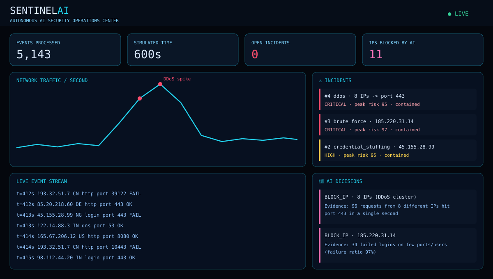

<h1 align="center">🛡️ SentinelAI</h1>
<h3 align="center">Autonomous AI Security Operations Center (AI-SOC)</h3>

<p align="center">
  <i>An AI that watches your network, detects attacks on its own, and responds — with a reason for every decision.</i>
</p>

<p align="center">
  
  
  
  
  
</p>

---

## 🚀 What is SentinelAI?

Real security teams drown in alerts. **SentinelAI** is a working prototype of the
next step: a **self-driving SOC**. It ingests a live network traffic stream,
learns what "normal" looks like, detects attack campaigns behaviourally,
and **responds on its own** — monitoring, throttling or blocking sources —
while explaining every decision in plain language.

Everything runs locally on simulated traffic. No setup, no API keys,
**zero dependencies** for the core.



## ⚡ Quickstart

```bash
git clone https://github.com/Master-creox/sentinel-ai-soc.git
cd sentinel-ai-soc

python main.py demo        # 300s simulated SOC run in your terminal
python dashboard.py        # futuristic HUD -> http://127.0.0.1:8000
python main.py eval        # detection benchmark (precision / recall)
python main.py report      # generate an incident report
```

## 🎯 What it detects — and does about it

| Attack | Behavioural signature | Autonomous response |
|---|---|---|
| **Brute force** | Many failed logins, few ports/users | Monitor → Block IP |
| **Credential stuffing** | Failed logins across many usernames | Monitor → Block IP |
| **Port scan** | Dozens of unique ports in 60s | Throttle → Block IP |
| **DDoS** | Request flood from many IPs on one port | Block the whole cluster |
| **C2 beaconing** | Tiny identical packets at regular intervals | Monitor → Block IP |

Every action ships with evidence, e.g.:

> `BLOCK_IP on 185.220.31.14: risk score 97 (brute_force). Evidence: 34 failed logins on few ports/users (failure ratio 97%)`

## 🧠 How it works

```
Traffic Simulator ──▶ Detection Engine ──▶ Autonomous Response ──▶ HUD Dashboard
 (live campaigns)     (per-IP behaviour     (graduated playbooks,     (live chart,
                        windows + scoring)    everything explained)    feeds, incidents)
```

- **Detection engine** — per-IP sliding 60-second windows extract behavioural
  features (rate vs. a learned baseline, failed logins, unique ports/users,
  failure ratio, packet regularity) and score each source 0–100 against
  attack signatures. Fully explainable by design.
- **Optional ML layer** — an Isolation Forest (`src/ml_detector.py`,
  `pip install -r requirements-ml.txt`) learns normal behaviour and flags
  outliers. Advisory only: in a real SOC, "why?" always beats a black box.
- **Response engine** — graduated SOAR-style playbooks:
  `MONITOR (45+) → THROTTLE (65+) → BLOCK_IP (85+)`, plus a DDoS cluster playbook.

Details: [docs/architecture.md](docs/architecture.md)

## 📊 Benchmark (simulated, seed 42, 600s)

| Metric | Result |
|---|---|
| Events processed | 5,143 |
| Attacking IPs | 12 |
| Detected | 12 (**recall 100%**) |
| False positives | 0 (**precision 100%**) |
| IPs blocked autonomously | 11 |

*Synthetic traffic — a smoke benchmark of the detection logic, not a
production claim. Run `python main.py eval` to reproduce.*

## 🗂️ Project structure

```
sentinel-ai-soc/
├── main.py               # CLI: demo | eval | report
├── dashboard.py          # HUD dashboard launcher
├── src/
│   ├── simulator.py      # live traffic + attack campaigns
│   ├── detector.py       # explainable detection engine
│   ├── ml_detector.py    # optional Isolation Forest layer
│   ├── responder.py      # autonomous response playbooks
│   ├── soc.py            # orchestrator (sim → detect → respond)
│   ├── report.py         # incident reports
│   ├── cli.py            # command-line interface
│   └── web_dashboard.py  # HUD web app (stdlib WSGI)
├── tests/                # pytest suite (8 tests)
└── docs/architecture.md
```

## 🛣️ Roadmap

- [ ] Ingest real log files (auth.log / nginx) instead of simulated traffic
- [ ] Threat-intel feed enrichment (known-bad IP lists)
- [ ] Email/Slack alerting for critical incidents
- [ ] Train the ML layer on the CICIDS2017 dataset
- [ ] Docker image + one-command deployment

## 👤 Author

**Akash Kumar** — BCA Cybersecurity student building AI-powered defensive
security tools.
GitHub: [@Master-creox](https://github.com/Master-creox) · YouTube: CreoX Tech Labs

## ⚖️ Ethics & license

Defensive security research and education only. All traffic and all
responses are simulated; SentinelAI never interacts with real systems.
Released under the [MIT License](LICENSE).
